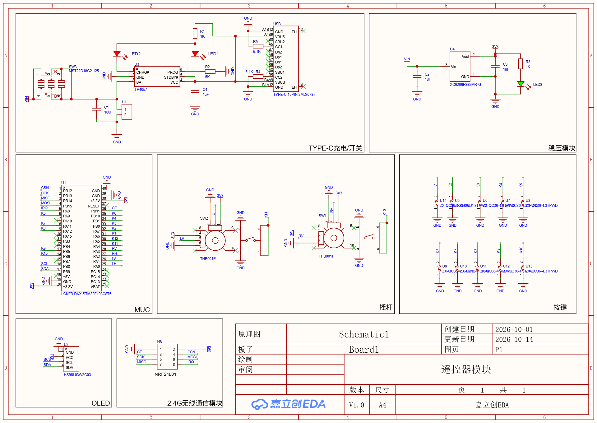
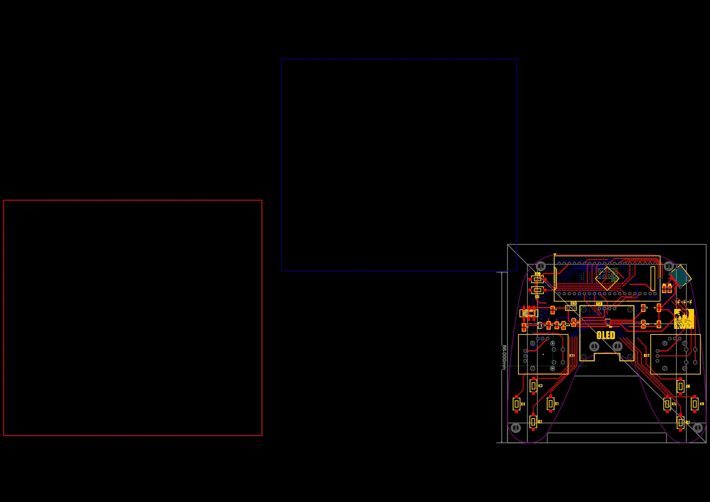

# 遥控器模块 · Remote Control Module

一块手持式 **2.4 GHz 无线遥控器**的完整硬件设计：STM32F103C8T6 核心板 + NRF24L01 无线 + 0.96" OLED + 双摇杆 + 10 键，锂电池供电、USB-C 充电。

设计工具：**嘉立创EDA 专业版 (LCEDA Pro) 3.2.149** ｜ 版本 **V1.0** ｜ 创建 2026-10-01，最后更新 2026-10-14





---

## 特性

- **双摇杆模拟量输入** —— 两路 THB001P 摇杆电位器，可做油门、转向、云台等连续量控制
- **10 个独立按键** —— ZX-QC36-4.3TPWD 轻触按键，丝印 K1–K10 均匀分布在握把两侧
- **2.4 GHz 无线** —— NRF24L01 模块经 2×4 排母直插，SPI 接口，可自行更换 PA/LNA 增强型模块
- **本地显示** —— 0.96 英寸 I2C OLED（HS96L03W2C03），实时显示通道值、电量、连接状态
- **锂电池供电 + USB-C 充电** —— TP4057 线性充电，双色 LED 指示充电状态，滑动开关关机
- **握把造型板框** —— 按手持控制器轮廓走线，按键与摇杆位置符合双手握持

## 硬件规格

| 项目 | 参数 |
| --- | --- |
| 主控 | 立创开发板 LCKFB-DKX-STM32F103C8T6（STM32F103C8T6 核心板，直插） |
| 无线 | NRF24L01（2.4 GHz，SPI：`CE` / `CSN` / `SCK` / `MOSI` / `MISO` / `IRQ`） |
| 显示 | HS96L03W2C03，0.96" OLED，I2C（`SCL` / `SDA`） |
| 人机输入 | 摇杆 ×2（THB001P）＋ 轻触按键 ×10（ZX-QC36-4.3TPWD） |
| 供电 | 单节锂电池，滑动开关 MST22D18G2 125 通断 |
| 充电 | USB-C 接口 + TP4057 线性充电，双色 LED 指示 |
| 稳压 | XC6206P332MR-G，3.3 V LDO |
| PCB | **2 层板**，37 个网络，65 个过孔 |
| 板框 | 握把造型；顶层铜箔包围盒约 **89.9 mm × 79.1 mm** |

> 精确外形尺寸以 `fabrication/` 中的 Gerber 为准（顶层铜箔包围盒只是下限估算）。

## 主要器件

| 位号 | 器件 | 说明 |
| --- | --- | --- |
| U1 | LCKFB-DKX-STM32F103C8T6 | 主控核心板，排针直插 |
| U2 | HS96L03W2C03 | 0.96" I2C OLED |
| U3 | TP4057 | 单节锂电线性充电管理 |
| U4 | XC6206P332MR-G | 3.3 V LDO（SOT-23） |
| U5–U13 | ZX-QC36-4.3TPWD | 轻触按键（K1–K10） |
| SW1 / SW2 | THB001P | 摇杆电位器 |
| SW3 | MST22D18G2 125 | 电源滑动开关 |
| USB1 | TYPE-C 16PIN 2MD(073) | USB-C 充电接口 |
| H8 | 2.54 mm 2×4 排母 | NRF24L01 模块插座 |
| H1 | 2.54 mm 1×2 排针 | 电池接口 |
| LED1 / LED2 | 0805 红 / 绿 | 充电状态指示 |
| LED3 | 0805 | 电源指示 |
| R4 / R5 | 5.1 kΩ | USB-C CC 下拉（Sink 识别） |

完整清单请见原理图，或在嘉立创EDA 中从工程直接导出 BOM。

## 功能模块划分

原理图按功能分为 7 个区块：

1. **TYPE-C 充电 / 开关** —— USB-C 接口、TP4057 充电电路、电池接口、电源滑动开关、充电指示 LED
2. **稳压模块** —— XC6206 把电池电压降到 3.3 V
3. **MCU** —— STM32F103C8T6 核心板，引出 SPI / I2C / GPIO
4. **摇杆** —— 两路 THB001P 电位器，经连接器接入
5. **按键** —— K1–K10 十个轻触键
6. **OLED** —— I2C 显示
7. **2.4G 无线通信模块** —— NRF24L01 SPI 接口

## 目录结构

```
.
├── README.md
├── LICENSE
├── hardware/
│   └── remote-control-module-v1.0.epro2   # 嘉立创EDA 专业版工程（原理图 + PCB + 内嵌库）
├── docs/
│   ├── schematic.jpg                      # 原理图预览
│   └── pcb-layout.jpg                     # PCB 预览
└── fabrication/                           # 生产文件（Gerber / BOM / 坐标）
    └── README.md
```

## 打开工程

1. 安装 **嘉立创EDA 专业版**（LCEDA Pro），版本 ≥ 3.2.149
2. 打开 `hardware/remote-control-module-v1.0.epro2`
3. 工程内含 1 张原理图（P1）、1 块 PCB（Board1），以及本项目用到的器件库（16 个封装、22 个符号、23 个器件），**不依赖外部库即可查看和改板**

> 原始文件名为 `ProPrj_遥控器模块_2026-10-17.epro2`，本仓库中重命名以便跨平台使用。

## 生产制造

`fabrication/` 目录用于放置导出的生产文件。当前**尚未提供**，请在嘉立创EDA 中导出后补充：

- Gerber（RS-274X）+ 钻孔文件
- BOM（物料清单，CSV）
- 坐标文件（Pick & Place，CSV）
- 原理图 PDF

## 固件

**本仓库仅包含硬件设计，不含固件源码。** 主控为 STM32F103C8T6，可通过核心板的 SWD 接口自行烧录。

## 许可证

[MIT](LICENSE) —— 可自由使用、修改、再分发，请保留版权声明。

> ⚠️ 工程内嵌的器件库中，部分封装与符号来自嘉立创EDA / 立创商城官方库（工程内 `source` 字段可追溯来源），其权利归原提供方所有，不在本项目 MIT 许可范围内。

## English

A handheld 2.4 GHz wireless remote controller: STM32F103C8T6 core board, NRF24L01 radio, 0.96" I2C OLED, dual thumbsticks, 10 tactile buttons, Li-ion powered with USB-C charging. Designed in **LCEDA Pro 3.2.149** (JLC EDA). Hardware design only — no firmware. Licensed under MIT.

---

**作者**：MIEMIEMIE ｜ **变更记录**

| 版本 | 日期 | 说明 |
| --- | --- | --- |
| V1.0 | 2026-10-14 | 首个版本 |
